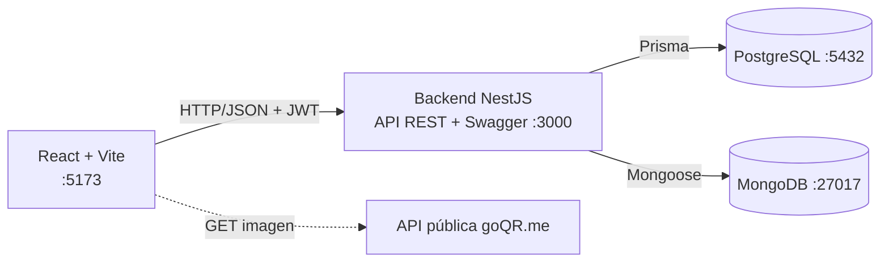
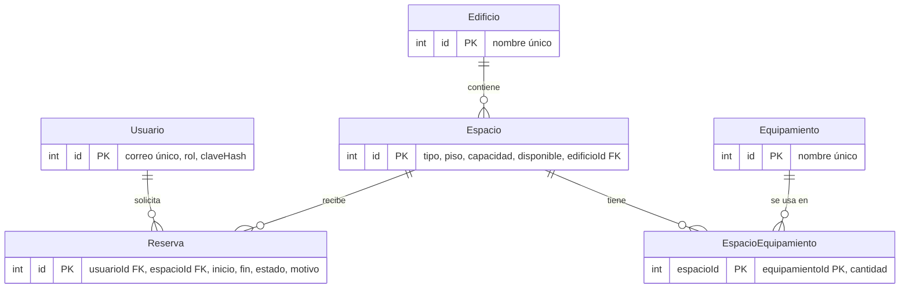

# Sistema de Reserva de Espacios Universitarios

Desarrollo Web y Móvil · Segundo Semestre 2026 · **Hito 3: plataforma web Full Stack**

## Integrantes

- Manuel Macchiavello
- Dhylan Pizarro
- Gabriel Hidalgo

## Problema y usuarios

Reservar salas, laboratorios y auditorios no es un proceso ágil ni visible: se arriesgan cruces de horario, no hay aprobación formal y nadie sabe qué espacios se usan realmente.

- **Estudiantes y docentes:** consultan espacios, solicitan reservas, las cancelan y ven su historial.
- **Administrador:** gestiona edificios y espacios, aprueba o rechaza solicitudes y revisa indicadores de uso.

## Continuidad con el Taller 2 y qué se agregó

| Taller 2 (prototipo) | Hito 3 (plataforma) |
| --- | --- |
| Datos en JSON y `localStorage` | Backend propio con API REST, PostgreSQL y MongoDB |
| Login simulado con hash en el cliente | Login con JWT, roles ESTUDIANTE / ADMIN y contraseñas con bcrypt en el servidor |
| 9 espacios fijos | Administración de edificios, espacios y equipamiento |
| Reserva inmediata, sin conflictos entre usuarios | Solicitud → aprobación / rechazo / cancelación, con validación de conflicto de horario |
| Sin historial ni indicadores | Historial por reserva (MongoDB) y panel de utilización |
| QR con API pública | Se mantiene, ahora solo para reservas aprobadas |

Funcionalidades obligatorias del caso "Gestión de espacios universitarios": administración de edificios/salas/laboratorios, capacidad, equipamiento, ubicación y disponibilidad, solicitudes con aprobación, rechazo y cancelación, validación de conflictos, reservas personales e historial, y panel de utilización. Todas están implementadas.

## Arquitectura



- **React:** interfaz, navegación, formularios y consumo de la API (`src/services/api.js` agrega el token y traduce errores; `src/hooks.js` entrega datos / carga / error).
- **Backend:** reglas de negocio, validación (`class-validator`), autorización por rol y acceso a ambas bases.
- **PostgreSQL:** datos relacionales y transaccionales.
- **MongoDB:** auditoría de reservas.
- **Docker Compose:** levanta los cuatro servicios.

## Tecnologías

| Capa | Tecnología |
| --- | --- |
| Frontend | React 19, Vite, React Router 7, Bootstrap 5, SweetAlert2 |
| Backend | NestJS 11, TypeScript 5, Prisma 6, Mongoose 8, JWT, class-validator, `@nestjs/swagger` |
| Datos | PostgreSQL 16, MongoDB 7 |
| Operación | Docker y Docker Compose, Node 22 (en contenedores) |

## Modelo SQL (PostgreSQL)



- Claves primarias y foráneas, `UNIQUE (edificioId, nombre)` en espacios, correo único y enumerados `Rol` y `EstadoReserva`.
- Índice `(espacioId, inicio, fin)` para la búsqueda de conflictos.
- **Reproducible:** las migraciones de Prisma y el *seed* (9 espacios, equipamiento y 2 usuarios) se ejecutan solos al iniciar el backend.
- **Conflicto de horario:** al crear una reserva se revisa, dentro de una transacción `Serializable`, que no exista otra PENDIENTE o APROBADA que se solape. Si hay choque la API responde 409.

## Justificación de MongoDB

Colección `auditoria_reservas`: un documento por evento (`CREADA`, `APROBADA`, `RECHAZADA`, `CANCELADA`) con `reservaId`, `usuarioId`, `rolUsuario`, `espacioId`, `fecha` y un `detalle` con la foto de la reserva en ese momento.

- Es un registro que solo crece, sin relaciones, y cuyo `detalle` no tiene estructura fija: encaja mejor como documentos que como tabla.
- **No duplica SQL:** Postgres guarda el estado actual de la reserva; Mongo guarda *quién hizo qué y cuándo*, que Postgres no conserva.
- Si Mongo falla, la reserva no se cae: el error se registra y se continúa.
- Se usa desde el botón **Historial** de "Mis reservas" y desde `GET /auditoria` (ADMIN).

## API

Documentación interactiva: **http://localhost:3000/docs** (Swagger). Para probar rutas protegidas: `POST /auth/login`, copiar el `token` y pulsar **Authorize**.

| Método y ruta | Propósito | Rol |
| --- | --- | --- |
| `POST /auth/registro`, `POST /auth/login` | Crear cuenta e iniciar sesión (devuelve JWT) | público |
| `GET /edificios`, `GET /edificios/:id` | Consultar edificios | autenticado |
| `POST`, `PATCH /:id`, `DELETE /:id` en `/edificios` | Administrar edificios | ADMIN |
| `GET /espacios` (`tipo`, `edificioId`, `q`), `GET /espacios/:id` | Listar y filtrar espacios | autenticado |
| `GET /espacios/:id/disponibilidad?fecha=` | Tramos ocupados de un día | autenticado |
| `GET /equipamiento` | Catálogo de equipamiento | autenticado |
| `POST`, `PATCH /:id`, `DELETE /:id` en `/espacios` | Administrar espacios | ADMIN |
| `POST /reservas` | Solicitar reserva (valida fechas y conflicto) | autenticado |
| `GET /reservas/mias` | Mis reservas | autenticado |
| `PATCH /reservas/:id/cancelar` | Cancelar (dueño o ADMIN) | autenticado |
| `GET /reservas?estado=` | Todas las solicitudes | ADMIN |
| `PATCH /reservas/:id/aprobar`, `/rechazar` | Resolver solicitud pendiente | ADMIN |
| `GET /reservas/:id/historial` | Historial de la reserva (Mongo) | dueño o ADMIN |
| `GET /auditoria` | Búsqueda de eventos de auditoría | ADMIN |
| `GET /panel/utilizacion?desde=&hasta=` | Indicadores de uso | ADMIN |
| `GET /health` | Estado del servicio | público |

Errores: 400 (validación), 401 (sin sesión o credenciales malas), 403 (rol o dueño), 404, 409 (conflicto de horario o estado inválido). Los mensajes no exponen detalles internos.

## API pública (QR)

- **API:** goQR.me (QR Server) · documentación: https://goqr.me/api/doc/create-qr-code/
- **Endpoint:** `GET https://api.qrserver.com/v1/create-qr-code/` con `size`, `margin`, `format=png` y `data`.
- **Qué consume y dónde:** la imagen PNG del QR de cada reserva **aprobada**, en "Mis reservas" (miniatura y popup con descarga).
- **Contenido:** `RESERVA:<id>|<sala>|<fecha>|<horario>|<nombre>`.
- **Frontend o backend:** frontend, porque solo se muestra una imagen y no se envía ningún dato sensible ni clave.
- **Errores:** si la descarga falla se abre la imagen en otra pestaña. No requiere clave.

## Cómo ejecutar (Docker Compose)

Requisitos: Git y Docker Desktop abierto. No hace falta instalar Node ni bases de datos.

```bash
git clone https://github.com/Dhylanp/Taller3_8568.git
cd Taller3_8568
cp .env.example .env      # en PowerShell: Copy-Item .env.example .env
docker compose up -d --build
```

| Servicio | Puerto | Descripción |
| --- | --- | --- |
| frontend | 5173 | React (http://localhost:5173) |
| backend | 3000 | API y Swagger (http://localhost:3000/docs) |
| postgres | 5432 | Base relacional |
| mongo | 27017 | Base documental |

El backend espera a que ambas bases estén sanas, aplica migraciones y carga los datos de prueba.

**Variables de entorno** (`.env.example`; el `.env` real no se sube):

| Variable | Uso |
| --- | --- |
| `POSTGRES_USER`, `POSTGRES_PASSWORD`, `POSTGRES_DB` | Credenciales de PostgreSQL |
| `DATABASE_URL` | Conexión de Prisma (host `postgres` dentro de Compose) |
| `MONGO_URL` | Conexión a MongoDB (host `mongo`) |
| `JWT_SECRET` | Firma de los tokens: cambiarlo |
| `CORS_ORIGIN` | Origen permitido del frontend |
| `VITE_API_URL` | URL de la API que usa React |

**Usuarios de prueba:** `dhylan@unab.cl` (ADMIN) y `estudiante@unab.cl` (ESTUDIANTE). Las claves del seed las entregan los integrantes; también se puede crear un estudiante con `POST /auth/registro`.

Detener: `docker compose down` (agregar `-v` para borrar los datos).

## Pruebas y verificación

- Lint y build del frontend sin errores (dentro del contenedor: `docker compose exec frontend npx eslint src`).
- Pruebas manuales por Swagger y por la interfaz: login correcto e incorrecto; reserva y choque de horario (409); aprobar, rechazar y cancelar; acceso de un estudiante a rutas de ADMIN (403); historial en Mongo; cuadrar a mano los totales del panel con las reservas aprobadas.
- No hay pruebas automatizadas.

## Limitaciones conocidas

- Sin pruebas automatizadas.
- Las horas se envían sin zona horaria y se muestran tal como las guarda la API; no hay manejo de husos.
- Los bloques de reserva son de 1 hora (08:00 a 18:00) definidos en el frontend.
- El % de ocupación del panel asume 9 horas útiles por día.
- El frontend corre con el servidor de desarrollo de Vite, no con una build servida por nginx.
- El QR depende de un servicio externo.

## Git

Repositorio con ramas `main` y `develop`; cada funcionalidad en su rama `feature/*` integrada por Pull Request (merge sin squash). El Taller 2 queda como punto de partida en el historial.

## Uso de Inteligencia Artificial

| Elemento | Detalle |
| --- | --- |
| Herramienta | Claude Code |
| Propósito | Diseño de la API y del modelo de datos, generación de código del backend y del frontend, depuración y documentación |
| Prompt representativo | "Evoluciona el Taller 2 a Full Stack con NestJS, PostgreSQL y MongoDB; valida conflictos de horario; el frontend debe consumir la API" |
| Resultado | Backend con autenticación, espacios, reservas, auditoría y panel; frontend conectado a la API; Docker Compose |
| Validación humana | Se levantó todo con Docker Compose; se probó cada endpoint en Swagger y cada flujo en la interfaz; se comprobó el choque de horario y el 403 por rol; se cuadraron a mano los totales del panel; lint y build sin errores |
| Aprendizaje | Por qué la validación de conflictos va en una transacción, por qué la auditoría va en MongoDB y el estado actual en SQL, y por qué la autorización se valida en el backend y no solo en el menú |

> Cada integrante debe poder explicar el código en la defensa.
